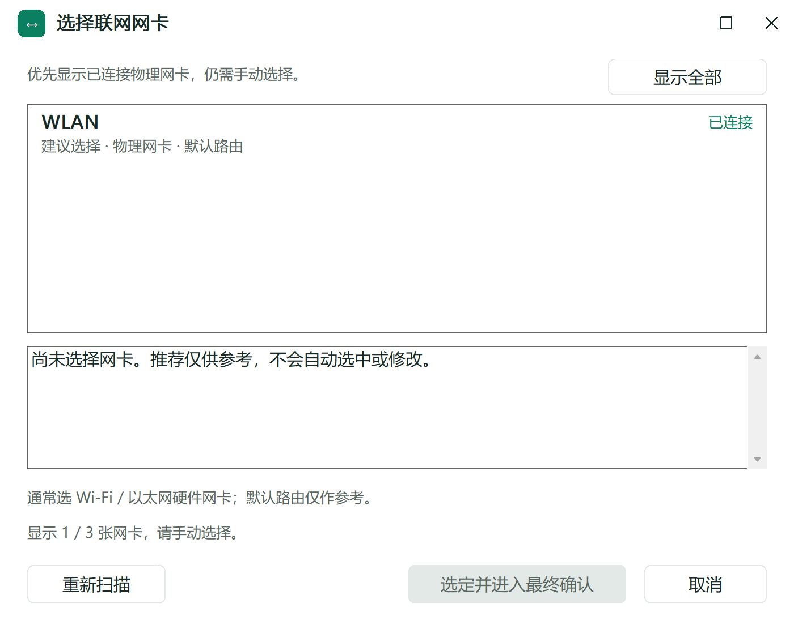

# OPPO互联占用虚拟网卡修复

**[项目介绍页：适用场景、使用方法与最新版下载](https://aidenglow.github.io/oppo-virtual-adapter-repair/)**

**安装 OPPO 互联后，Clash / Mihomo 开启 TUN 模式就断网、无法联网？** 这是一个面向 Windows 的中文修复工具，将 OPPO 程序文件处理、代理联网网卡配置和备份恢复放在同一个界面里，帮助排查 OPPO 互联与 TUN 虚拟网卡的兼容性冲突。

**Windows 10 / 11 · 64 位 · 单文件 EXE · 支持 Clash Verge Rev 和 Clash for Windows · 当前稳定版 v1.11.0**

## 下载与运行

> **普通 Windows 用户直接下载：[Windows 64 位 EXE（点击下载）](https://github.com/AidenGlow/oppo-virtual-adapter-repair/releases/latest/download/oppo-virtual-adapter-repair-windows-amd64.exe)。**
>
> 下载后双击，在 Windows 管理员授权窗口点击“是”即可使用，无需安装 Go 或 Python。`amd64` 表示 x64 架构，Intel 和 AMD 的 64 位电脑都适用。

- **只使用工具**：下载上面的 `oppo-virtual-adapter-repair-windows-amd64.exe`。
- **需要程序、源码和中文说明**：下载[完整包 ZIP](https://github.com/AidenGlow/oppo-virtual-adapter-repair/releases/latest/download/oppo-virtual-adapter-repair-windows-amd64-full.zip)，解压后运行 EXE。
- **核对文件完整性**：下载 [SHA256-latest.txt](https://github.com/AidenGlow/oppo-virtual-adapter-repair/releases/latest/download/SHA256-latest.txt)。
- **[稳定版发布页面](https://github.com/AidenGlow/oppo-virtual-adapter-repair/releases/latest)**：统一下载入口；页面里的 `Source code (zip)` / `Source code (tar.gz)` 为源码包。

## 解决什么问题

本工具针对 Windows 电脑上的以下场景：

- 安装或启动 OPPO 互联后，Clash / Mihomo 原本可用的 **TUN 模式失效、开启即断网**。
- OPPO 互联引入额外虚拟网卡，代理的实际联网出口受到干扰，需要明确指定 Wi-Fi 或以太网。
- 希望通过可确认、可恢复的操作排查冲突，减少手动找 DLL、找 YAML 和改错网卡的问题。

Clash Verge Rev 的[讨论 #6712](https://github.com/clash-verge-rev/clash-verge-rev/discussions/6712)记录了安装 OPPO 互联后新增 `utun8`、TUN 无法联网的案例。代理出口选择或路由受到影响是结合该案例与 Mihomo 机制的解释，具体故障环节应结合本机日志核对。案例依据和两种方式的作用见[原因说明](docs/原因说明.md)。

## 两种修复方式，自主选择

两种方式独立使用，无需依次执行。

| 方式 | 作用 | 操作前提与完成后处理 |
| --- | --- | --- |
| **OPPO DLL 修复** | 自动寻找 OPPO 安装目录中的 `daemon/wintun.dll`，确认后改名以排查相关组件冲突，支持恢复原名 | 先登录 OPPO 互联并保持手机连接；修复和恢复后均需重启电脑。修改可能影响新设备连接 |
| **Clash / Mihomo 配置** | 自动识别 Clash Verge Rev / Clash for Windows 的配置，由用户选择实际联网网卡，明确 TUN 出口 | 先完全退出代理客户端；确认修改后重新打开。换网络、订阅刷新或扩展脚本可能要求重新核对设置 |

## 如何使用

1. 选择一种修复方式，等待工具定位文件；特殊路径可手动指定。
2. DLL 方式核对目录并确认手机已连接；配置方式先退出代理软件，再扫描并选择实际联网网卡。默认只显示已连接物理网卡，也可查看全部网卡。
3. 核对最终确认窗口中的文件路径和修改内容，确认后执行。
4. 按提示重启电脑或重开代理客户端。配置方式可点击“检查是否生效”，查看运行内核是否采用了设置，再打开常用网页确认联网。

**打开界面、识别配置、扫描网卡和检查是否生效均只读；文件修改需要最终确认。** 工具处理用户选定的文件，保留备份；不安装驱动、不调整系统 DNS、路由表或全局代理。

## 遇到问题可恢复

| 操作 | 恢复范围 |
| --- | --- |
| **恢复 DLL** | 将原目录的 `wintun.dll.oppo互联` 恢复为 `wintun.dll`，完成后重启电脑 |
| **只撤销网卡设置** | 选择原修复记录，预览并确认后，只还原本工具改过的网卡字段，保留后来修改的节点、规则和其他设置；网卡字段有冲突时停止 |
| **恢复 YAML 备份** | 自动列出当前配置的备份，按时间选择并最终确认后还原整份文件，会覆盖备份之后的修改；恢复前另存当前配置 |

请将原 `.bak` 和旁边的 `.bak.oppo-repair.json` 一起保留。删除工具后重新下载仍可恢复；只有 `.bak` 的旧备份可以整份恢复。两种 YAML 恢复入口都保留手动选择文件。

## 常见问题

### OPPO互联导致VPN失效，这个工具适用吗？

如果你说的“VPN 失效”是 **Windows 安装 OPPO 互联后，Clash / Mihomo 的 TUN 模式无法联网**，可以使用本工具排查。当前支持 Clash Verge Rev 和 Clash for Windows 的配置识别；OPPO 手机上的 VPN 应用问题属于另一类场景。

### 修复失败时怎样处理？

工具区分权限不足、文件被占用和路径失效，并给出下一步操作。占用相关失败会尝试显示程序名称、PID 和服务名，方便保存工作后正常退出；查询失败或未识别到程序时保留排查指引。详细步骤见[使用说明](docs/使用说明.md)。

### 恢复会覆盖后来改过的节点和规则吗？

“只撤销网卡设置”保留当前节点和规则；“恢复 YAML 备份”还原整份配置。请按需要选择恢复范围，并保存原备份及对应撤销记录。

## 界面示例

以下截图使用样本配置和网卡信息：




## 验证与说明

当前稳定版已通过 **82 项顶层测试、31 个模糊测试种子，0 失败**；1 项符号链接测试因系统权限不足跳过。临时文件验证了修复、保留后改节点和规则的局部撤销、整份恢复及真实文件占用程序识别。测试范围和复现记录见 [TEST_RESULTS.md](TEST_RESULTS.md)。

本项目是第三方工具。实际连接效果取决于软件版本和网络环境；具体操作前提及恢复条件见[使用说明](docs/使用说明.md)，版本改动记录在 [CHANGELOG](CHANGELOG.md)。

## 从源码运行和编译

采用 **Go + 原生 Win32 API**，依赖源码已放在 `source/vendor/`，可离线构建。在 Windows 安装 Go 1.23 或更新版本后，在管理员终端执行测试和构建（测试 EXE 也包含提权声明）：

```powershell
Set-Location 'source'
go test -mod=vendor -count=1 ./...
go vet -mod=vendor ./...
go build -trimpath -mod=vendor -ldflags='-H windowsgui -s -w' -o '..\OPPO互联连接修复工具_v1.11.0.exe' .
```

本版实际使用 Go 1.27.2 构建；未使用 Go 1.23 工具链复测。发布构建使用 `-trimpath` 去除本机编译路径。修改 `app.manifest` 后先运行 `go generate .`。

自有代码使用 [MIT 许可证](LICENSE)。第三方组件和软件图标的来源及许可见 [THIRD_PARTY_NOTICES.txt](THIRD_PARTY_NOTICES.txt)。版本变化见 [CHANGELOG](CHANGELOG.md)。

发布附件和固定下载地址的维护方法见[发布说明](docs/发布说明.md)。
