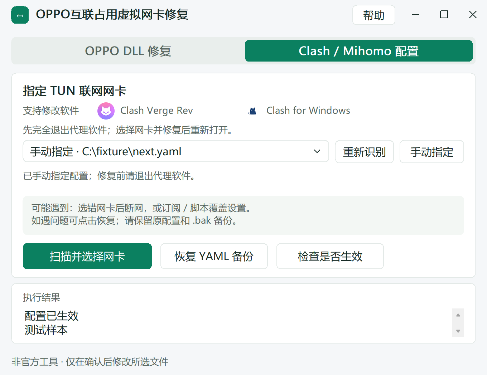

# OPPO互联占用虚拟网卡修复

一个用于排查 **OPPO 互联与 Clash / Mihomo TUN 网络冲突**的 Windows 小工具：自动找到需要处理的文件，你选择修复方式，确认后再修改，遇到问题可以恢复。

**Windows 10 / 11 · 64 位 · 中文界面 · 单文件 EXE · 当前 v1.9 测试版**

## 为什么做这个工具

本项目针对的一类问题是：**安装 OPPO 互联后，Clash / Mihomo 原本可用的 TUN 模式一开启就无法联网。**

Clash Verge Rev 的 [讨论 #6712](https://github.com/clash-verge-rev/clash-verge-rev/discussions/6712) 记录了一个案例：安装 OPPO 互联后新增虚拟网卡 `utun8`，开启 TUN 即断网；单独卸载该网卡，重启后又会出现；卸载 OPPO 互联后，网卡移除，TUN 恢复。

**这个案例指向 OPPO 互联引入的虚拟网卡与代理 TUN 共存时的网络冲突。** 为什么会影响整机上网？Mihomo 的 TUN 在启用自动路由时会接收全局流量，处理后的连接仍需通过实际联网网卡发出。结合其[自动选择出口接口的机制](https://wiki.metacubex.one/config/inbound/tun/#auto-detect-interface)，一个合理推断是：新增虚拟网卡影响了出口识别或路由，使流量进入 TUN 后没有从正确的联网接口发出，于是表现为“打开 TUN 就断网”。

截图没有路由表和内核日志，具体冲突环节仍待确认；`utun8` 也是该案例的网卡名，其他电脑可能不同。详细依据、为什么删网卡后会重现，以及两种修复方式的作用见 [原因说明](docs/原因说明.md)。

这个工具把社区排障中的 DLL 改名和代理出口网卡配置放到同一个中文界面里，自动寻找目标文件、显示网卡信息，并提供备份和恢复，减少手动找文件、改错位置和忘记备份的问题。

这两种方法适用于不同情况，可以自行选择其中一种，无需依次执行。它们来自社区排障经验，实际连接效果取决于软件版本和网络环境。本项目是第三方工具。

## 两种方式分别解决什么

| 方式 | 处理什么 | 需要注意 |
| --- | --- | --- |
| **OPPO DLL 修复** | 将 OPPO 安装目录中 `daemon\wintun.dll` 改名为 `wintun.dll.oppo互联`，用于尝试排查相关组件冲突；支持改回原名 | 必须先登录 OPPO 互联并连接手机。修复和恢复后都要重启电脑；修改后可能无法连接新设备 |
| **Clash / Mihomo 配置** | 为 TUN 明确指定实际联网的 Wi-Fi / 以太网，避免依赖自动选择出口网卡；自动识别 Clash Verge Rev 和 Clash for Windows 的配置 | 修改前完全退出代理软件；由你选择网卡，完成后重新打开。订阅刷新或脚本可能覆盖设置 |

## 下载和使用

[下载 Windows 64 位 EXE](https://github.com/AidenGlow/oppo-virtual-adapter-repair/raw/refs/heads/main/downloads/OPPO%E4%BA%92%E8%81%94%E8%BF%9E%E6%8E%A5%E4%BF%AE%E5%A4%8D%E5%B7%A5%E5%85%B7_v1.9.exe) · [下载完整包](https://github.com/AidenGlow/oppo-virtual-adapter-repair/raw/refs/heads/main/downloads/OPPO%E4%BA%92%E8%81%94%E8%BF%9E%E6%8E%A5%E4%BF%AE%E5%A4%8D%E5%B7%A5%E5%85%B7_v1.9_%E5%AE%8C%E6%95%B4%E5%8C%85.zip)

双击 EXE 即可运行，无需安装 Go 或 Python。程序未签名，Windows 可能显示“未知发布者”；修改受保护的安装目录时可能需要管理员权限。

1. **选择一种修复方式**，等待工具自动找到 OPPO 文件或代理客户端配置。
2. DLL 方式先核对目录，并勾选手机已连接；配置方式先退出代理客户端，再扫描、选择实际联网的网卡。
3. 阅读最终确认窗口，核对文件路径和改动，点击“是”后才会修改。
4. 按提示重启电脑或重新打开代理软件，检查连接是否恢复。

**只打开界面、识别配置或扫描网卡不会修改配置。取消最终确认也不会修改。** 工具只处理明确选中的文件，保留用户选择和确认；不安装驱动、不修改系统 DNS、路由表或全局代理。

## 出现问题怎样恢复

- **DLL：**选择原目录中的 `wintun.dll.oppo互联`，点击“恢复 DLL”，确认后重启电脑。
- **YAML：**选择对应客户端 / 配置，点击“恢复 YAML 备份”。工具会自动列出当前配置同目录的备份，按时间从新到旧排列；由你选一份，再最终确认。找不到时可点“手动选择文件…”。恢复前还会另存当前配置。
- **删掉工具后仍可恢复：**重新下载工具即可，前提是原目录中的已改名 DLL，或原 YAML 及旁边的 `.bak` 还在。请保留这些文件和所在目录。

详细步骤见 [使用说明](docs/使用说明.md)。

## 界面示例

以下截图使用虚拟配置路径：



## 测试到哪一步了

- v1.9 回归：**50 项测试、31 个模糊测试种子通过，0 失败**；1 项符号链接测试因系统权限不足跳过。`go vet` 和离线 Windows x64 构建通过。
- 额外用临时 YAML 完整跑通 **修复 → 自动查找备份 → 列表选择 → 最终确认 → 恢复**，包含实际文件写入；恢复后的字节和 SHA256 与原文件一致，恢复前保护备份也核对通过。
- 真实手机连接、真实代理配置修改后的网络效果，以及全部 Windows / 客户端版本尚未联调验证。

记录和复现方法见 [测试结果](TEST_RESULTS.md)。

## 从源码运行和编译

采用 **Go + 原生 Win32 API**，依赖源码已放在 `source/vendor/`，可离线构建。在 Windows 安装 Go 1.23 或更新版本后：

```powershell
Set-Location 'source'
go test -mod=vendor -count=1 ./...
go vet -mod=vendor ./...
go build -trimpath -mod=vendor -ldflags='-H windowsgui -s -w' -o '..\OPPO互联连接修复工具_v1.9.exe' .
```

本版实际使用 Go 1.27.2 构建；未使用 Go 1.23 工具链复测。发布构建使用 `-trimpath` 去除本机编译路径。修改 `app.manifest` 后先运行 `go generate .`。

自有代码使用 [MIT 许可证](LICENSE)。第三方组件和软件图标的来源及许可见 [THIRD_PARTY_NOTICES.txt](THIRD_PARTY_NOTICES.txt)。版本变化见 [CHANGELOG](CHANGELOG.md)。
